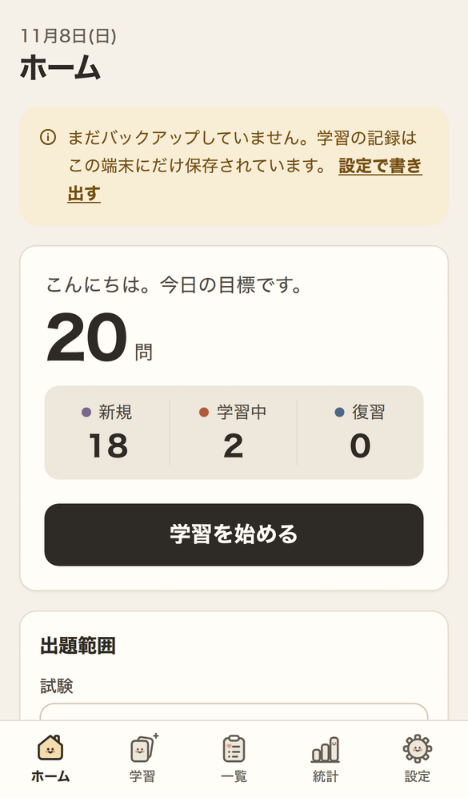
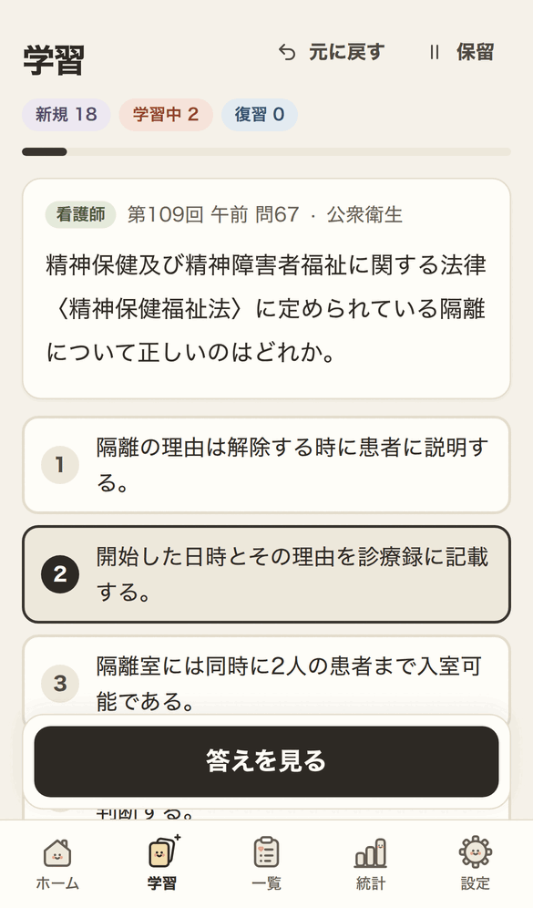
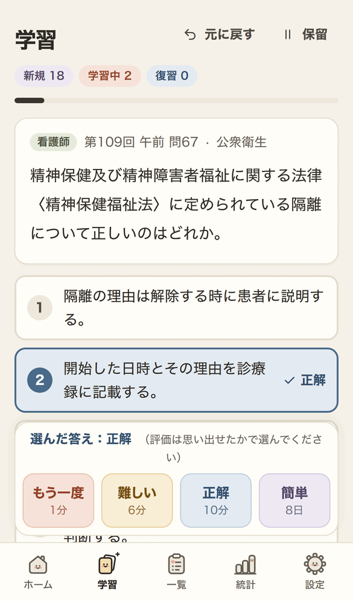
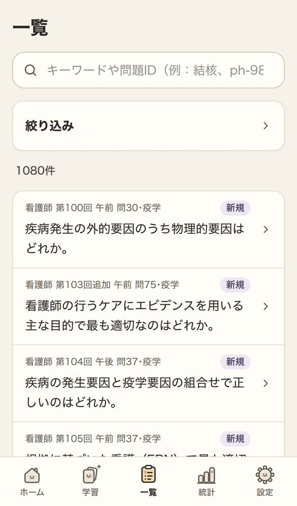

# NursePastExam

An Anki-like web app (PWA) for practising past questions from the Japanese national nurse exam (看護師国家試験) and the national public health nurse exam (保健師国家試験), with spaced repetition.

The questions are limited to **epidemiology and public health**. Other subjects are not included. The questions and answers on these topics were extracted, and sorted into categories, using the keywords of the 保健師助産師看護師国家試験出題基準（令和5年版）.

| Exam | Rounds | Categories |
|---|---|---|
| 看護師国家試験 (nurse) | 第99回〜第115回 (2010–2026) | 疫学, 公衆衛生 |
| 保健師国家試験 (public health nurse) | 第96回〜第112回 (2010–2026) | 疫学, 保健統計, 保健医療福祉行政論, 公衆衛生 |

## Screenshots

| Home | Question | Answer and rating | Question list |
|:---:|:---:|:---:|:---:|
|  |  |  |  |
| Today's goal and a study button | Pick an answer, then show it | See the answer, then rate your recall | Search and filter every question |

See `specification.md` for features and `development_plan.md` for the build phases.

## Running

```sh
npm install
npm run import     # build public/data and public/images from content/
npm run dev        # development server at http://localhost:5173
npm run build && npx vite preview --host   # the production build, with offline support
```

Progress is stored only in the browser. Export it regularly from 設定 → バックアップ.

**On a phone.** `npx vite preview --host` prints a network address that a phone on the same Wi-Fi can open. Studying works there, but browsers only enable the service worker (offline use and installing to the home screen) on `https://` or `localhost`. To install the app on a phone, serve the build over HTTPS, for example with `tailscale serve` or another tunnel that provides a certificate. Then use "ホーム画面に追加" in Safari (iOS) or "アプリをインストール" in Chrome (Android).

## Sources and licence

### Exam questions and answers

The questions, choices, answers, figures and tables in `content/` come from the past exam questions and answers that the Ministry of Health, Labour and Welfare (厚生労働省) publishes on its website. They are used under the [MHLW terms of use](https://www.mhlw.go.jp/chosakuken/index.html), which apply the [Public Data License 1.0 (PDL1.0)](https://www.digital.go.jp/resources/open_data/public_data_license_v1.0).

> 出典：厚生労働省ホームページ「看護師国家試験・保健師国家試験の問題および正答」（看護師 第99回〜第115回、保健師 第96回〜第112回。各回のURLは下表のとおり）
>
> 本リポジトリの作成者（tomishing）が、上記の問題・正答から、保健師助産師看護師国家試験出題基準（令和5年版）に基づいて疫学・公衆衛生関連の問題を抽出し、分類・書式変換等の加工を行って作成したものです。第96・97回保健師国家試験の問題は OCR によりテキスト化し、作成者が確認しました。

| 実施年 | 看護師 | 保健師 | 出典ページ |
|---|---|---|---|
| 2010 | 第99回 | 第96回 | [厚生労働省](https://www.mhlw.go.jp/topics/2010/04/tp0414-3.html) |
| 2011 | 第100回 | 第97回 | [厚生労働省](https://www.mhlw.go.jp/topics/2011/04/tp0414-3.html) |
| 2012 | 第101回 | 第98回 | [厚生労働省](https://www.mhlw.go.jp/topics/2012/04/tp0420-03.html) |
| 2013 | 第102回 | 第99回 | [厚生労働省](https://www.mhlw.go.jp/seisakunitsuite/bunya/kenkou_iryou/iryou/topics/tp130723-03.html) |
| 2014 | 第103回・第103回追加 | 第100回 | [厚生労働省](https://www.mhlw.go.jp/seisakunitsuite/bunya/kenkou_iryou/iryou/topics/tp140512-03.html) |
| 2015 | 第104回 | 第101回 | [厚生労働省](https://www.mhlw.go.jp/seisakunitsuite/bunya/kenkou_iryou/iryou/topics/tp150511-03.html) |
| 2016 | 第105回 | 第102回 | [厚生労働省](https://www.mhlw.go.jp/seisakunitsuite/bunya/kenkou_iryou/iryou/topics/tp160411-03.html) |
| 2017 | 第106回 | 第103回 | [厚生労働省](https://www.mhlw.go.jp/seisakunitsuite/bunya/kenkou_iryou/iryou/topics/tp170425-03_04_05.html) |
| 2018 | 第107回 | 第104回 | [厚生労働省](https://www.mhlw.go.jp/seisakunitsuite/bunya/kenkou_iryou/iryou/topics/tp180511-03_04_05.html) |
| 2019 | 第108回 | 第105回 | [厚生労働省](https://www.mhlw.go.jp/seisakunitsuite/bunya/kenkou_iryou/iryou/topics/tp190415-03_04_05.html) |
| 2020 | 第109回 | 第106回 | [厚生労働省](https://www.mhlw.go.jp/seisakunitsuite/bunya/kenkou_iryou/iryou/topics/tp200414-03_04_05.html) |
| 2021 | 第110回 | 第107回 | [厚生労働省](https://www.mhlw.go.jp/seisakunitsuite/bunya/kenkou_iryou/iryou/topics/tp210416-03_04_05.html) |
| 2022 | 第111回 | 第108回 | [厚生労働省](https://www.mhlw.go.jp/seisakunitsuite/bunya/kenkou_iryou/iryou/topics/tp220421-03_04_05.html) |
| 2023 | 第112回 | 第109回 | [厚生労働省](https://www.mhlw.go.jp/seisakunitsuite/bunya/kenkou_iryou/iryou/topics/tp230524-03_04_05.html) |
| 2024 | 第113回 | 第110回 | [厚生労働省](https://www.mhlw.go.jp/seisakunitsuite/bunya/kenkou_iryou/iryou/topics/tp240424-03_04_05.html) |
| 2025 | 第114回 | 第111回 | [厚生労働省](https://www.mhlw.go.jp/seisakunitsuite/bunya/kenkou_iryou/iryou/topics/tp250428-03_04_05.html) |
| 2026 | 第115回 | 第112回 | [厚生労働省](https://www.mhlw.go.jp/seisakunitsuite/bunya/kenkou_iryou/iryou/topics/tp260424-03_04_05.html) |

Links checked on 2026-11-07. Each page also covers that year's 助産師国家試験, which this app does not use. The same table is in `content/info.md`, which the import reads.

This content has been edited and is **not** an official MHLW publication. MHLW has not reviewed or endorsed this app.

Under PDL1.0, content in which a third party holds copyright or other rights is not covered by MHLW's permission. Anyone reusing figures or tables from `content/` must check those rights themselves.

### Explanations

The explanations (`Explanation` column) were written with Claude (Anthropic). They are **not official** and have not been fully reviewed. Statistics are as of each exam year, and laws may have changed since. They are not covered by the MHLW terms or PDL1.0.

### Code

No licence has been chosen for the code yet. Any future code licence will not apply to `content/`, which stays under the terms above.
